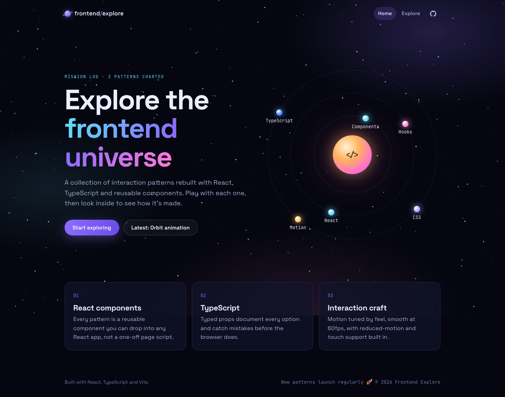
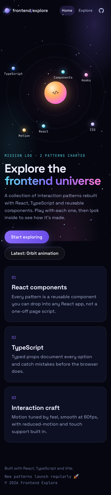
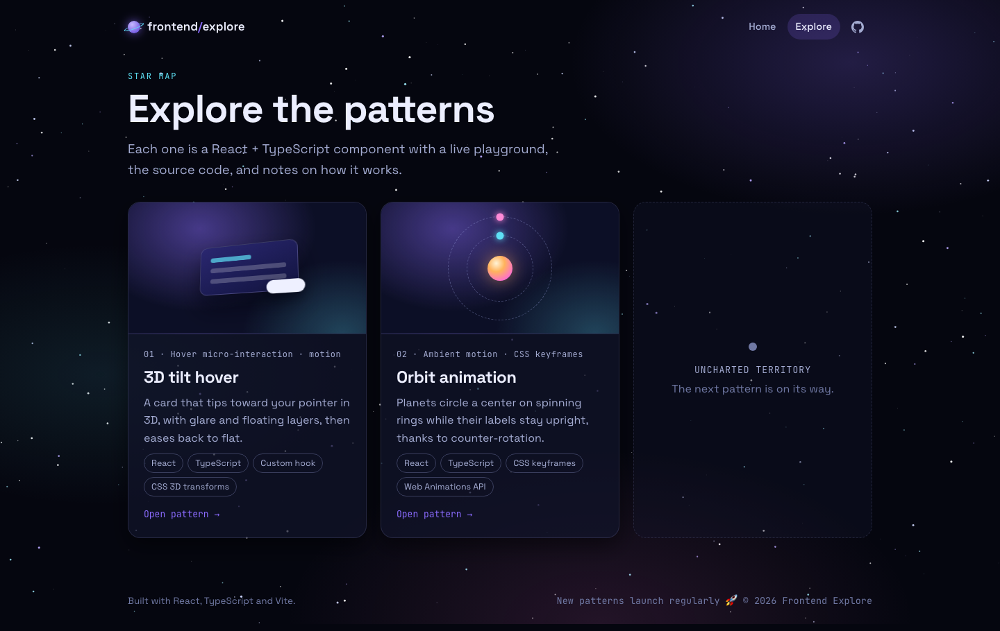
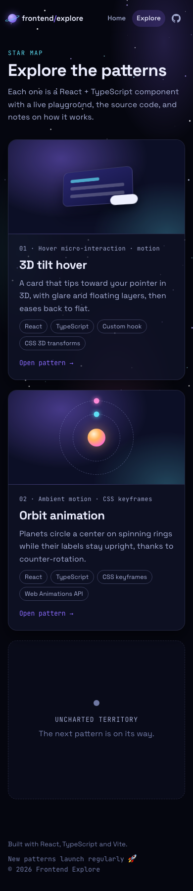
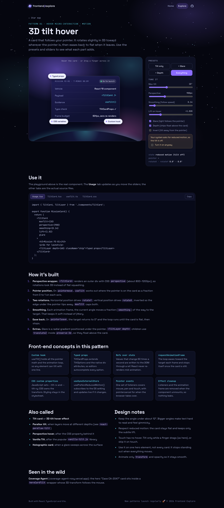
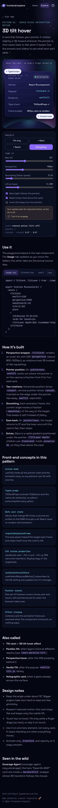

# v1 vibe

Studied from the live site (`frontendexplore.vercel.app`) and the `main` branch on 2026-11-19. Screenshots are in `screenshots/`, taken with reduced motion on so the stars hold still and the shots compare cleanly.

| Page | Desktop (1440) | Mobile (390) |
| --- | --- | --- |
| Home |  |  |
| `/explore` |  |  |
| `/explore/3d-tilt-hover` |  |  |

No page scrolls sideways at either width.

## The feel in one line

Deep space at night: near-black navy, a slow starfield, soft violet, cyan and pink nebula glows, glassy panels, and mono "mission log" labels next to a friendly rounded grotesk.

## Tokens

v2 names are new and prefixed `--fe-` so they never clash with a pattern's own variables (such as `--tilt-rx`). Values are copied from v1's CSS.

### Color

| v2 token | Value | v1 source | Used for |
| --- | --- | --- | --- |
| `--fe-bg` | `#05060f` | `--space-0` | page background, `theme-color` |
| `--fe-bg-raised` | `#0a0c1d` | `--space-1` | unused in v1, kept for parity |
| `--fe-surface` | `rgba(16, 19, 42, 0.72)` | `--panel` | cards, pillars, controls panel (with `blur(6px)`) |
| `--fe-surface-solid` | `#10132a` | `--panel-solid` | solid panel |
| `--fe-surface-code` | `#070918` | code block | code block body |
| `--fe-surface-stage` | `#0a0c22` | `.stage` | playground stage base |
| `--fe-surface-thumb` | `#0c0f26` | `.pattern-card__thumb` | gallery thumbnail base |
| `--fe-border` | `rgba(160, 170, 230, 0.16)` | `--line` | hairlines |
| `--fe-border-strong` | `rgba(160, 170, 230, 0.3)` | `--line-strong` | ghost buttons, tags, preset buttons |
| `--fe-text` | `#eceeff` | `--ink` | body text, headings |
| `--fe-text-muted` | `#a3abd1` | `--muted` | ledes, paragraphs |
| `--fe-text-faint` | `#6f78a3` | `--faint` | footer, readouts |
| `--fe-text-code` | `#d6dcff` | code block | code text |
| `--fe-violet` | `#8b6cff` | `--violet` | accent: buttons, active states, markers |
| `--fe-cyan` | `#5ee0f5` | `--cyan` | kickers, links, focus ring |
| `--fe-pink` | `#ff7ad9` | `--pink` | gradient end, nebula |
| `--fe-amber` | `#ffc46b` | `--amber` | reduced-motion notice |
| `--fe-green` | `#5fe3a1` | status pill dot | "Go for launch" |

Recurring tints: violet at 0.14 (inline code), 0.18 (active nav), 0.2 to 0.25 (selected tab, segmented), 0.35 to 0.5 (button glow). Inline code text is `#d9d0ff`.

### Type

- Sans: **Space Grotesk** 400 to 700. Mono: **JetBrains Mono** 400 and 600. Both from Google Fonts.
- Body 16px, line height 1.6.
- Headings: letter spacing -0.02em, line height 1.1.
- Hero H1: `clamp(42px, 7vw, 80px)`, line height 1.02, letter spacing -0.035em.
- Page H1: `clamp(34px, 6vw, 56px)`. Section H2: `clamp(24px, 3.4vw, 32px)`.
- Kicker: mono, 12px, uppercase, letter spacing 0.14em, cyan.
- Lede: `clamp(16px, 2vw, 18.5px)`, muted, max 640px wide.
- Gradient text: 100deg, cyan to violet to pink.

### Spacing, radius, shadow

- Page width 1120px. Gutter 24px, 16px at 640px and below.
- Sections on a pattern page: 56px apart.
- Radius: 18px (cards, panels, code), 22px (stage), 14px (concept tiles), 12px (segmented), 10px (preset buttons, notices), 8px (tabs), 999px (buttons, tags, nav pills).
- Primary button: violet gradient, glow `0 8px 30px rgba(139, 108, 255, 0.35)`, lifts 2px on hover.
- Gallery cards: heavy soft drop shadow that grows while tilted.

### Motion

- Starfield: canvas, up to 420 stars, drift upward slowly, closer stars faster, each one twinkles. Still under reduced motion.
- Three fixed nebula glows: violet top right, cyan left, pink bottom.
- Hover transitions 0.2s ease. Orbit tilt eases with `cubic-bezier(0.2, 0.7, 0.2, 1)` over 0.6s.
- Uncharted card: a dot that pings every 2.4s.
- Reduced motion: a global rule cuts every animation and transition to near zero.

## Layouts

**Header.** Planet logo with a cyan Saturn ring, then the wordmark `frontend/explore` with a violet slash. Right side: Home and Explore as pill links (active one has a violet tint), then a GitHub icon. The GitHub link still points at the old `frontendexplore` address.

**Footer.** Left: "Built with React, TypeScript and Vite." Right, in mono: "New patterns launch regularly 🚀 © 2026 Frontend Explore". On phones the copyright drops to its own line.

**Home.** Two columns. Left: kicker "Mission log · 2 patterns charted", the big H1 "Explore the frontend universe" with a gradient on the last two words, a lede, then a violet "Start exploring" button and a ghost "Latest: Orbit animation" button. Right: the orbit system with the stack as planets around a glowing `</>` sun. Below: three glass pillar cards numbered 01 to 03. On mobile the orbit moves above the copy.

**`/explore`.** Kicker "Star map", H1 "Explore the patterns", a lede, then a grid of tilt cards (min 320px each). Each card: a thumbnail on a violet and cyan glow, a mono meta line (number and category), title, summary, skill tags, and a violet "Open pattern →". The last tile is a dashed "Uncharted territory" card with a pinging dot.

**Pattern page.** "← Star map" back link, mono kicker "Pattern 01 · category", H1, lede. Then the playground: a stage on the left with a glowing planet rim along its bottom edge, and a 320px controls panel on the right (stacks below 900px). Then sections: Use it (tabbed code with a live Usage tab), How it's built (numbered steps with violet mono markers), Front-end concepts (grid of tiles with cyan mono titles), Also called and Design notes side by side, Seen in the wild.

## Copy

Short, friendly and concrete, with a light space theme that never gets in the way: "Mission log", "Star map", "Uncharted territory", "Warping in…", "Lost in space". Instructions speak directly to the reader ("Hover the card · or drag a finger across it"). Technical names sit in inline code.

## Controls panel

A glass panel with small mono uppercase headings ("Presets", "Tune it"). Presets are a 2 or 3 column grid of outlined buttons; the active one fills violet. Sliders show a label on the left and a mono value on the right. Checkboxes and sliders use violet as the accent color. An amber notice appears when the system asks for reduced motion, with a "Turn it on anyway" option on the tilt page. A mono readout at the bottom shows live state, written to the DOM every frame without re-rendering React.

## Gaps not to carry over

- Accessibility notes are mixed into design notes.
- No links between patterns, and no search.
- The wordmark uses a slash (the naming rule says no slash), and the GitHub link uses the old repo name.

## v2 against v1 (Phase 0 check, 2026-11-19)

Same widths, same settings (reduced motion on). Star positions are random on every load, so they differ between shots by design.

| Page | Desktop | Mobile | Page height |
| --- | --- | --- | --- |
| Home | [v1](screenshots/v1-home-desktop.png) · [v2](screenshots/v2-home-desktop.png) | [v1](screenshots/v1-home-mobile.png) · [v2](screenshots/v2-home-mobile.png) | equal at both widths |
| `/explore` | [v1](screenshots/v1-explore-desktop.png) · [v2](screenshots/v2-explore-desktop.png) | [v1](screenshots/v1-explore-mobile.png) · [v2](screenshots/v2-explore-mobile.png) | equal at both widths |
| Tilt pattern | [v1](screenshots/v1-tilt-desktop.png) · [v2](screenshots/v2-tilt-desktop.png) | [v1](screenshots/v1-tilt-mobile.png) · [v2](screenshots/v2-tilt-mobile.png) | equal at both widths |

Differences on purpose:

- Wordmark reads `frontend-explore` (naming rule: no slash). Final choice is the owner's.
- GitHub link points at `frontend-explore`.
- Sliders now have proper names for screen readers ("Max tilt, 10°"). In v1 the value readout inside the label took the name, so a screen reader said only "slider, 10". No visual change.
- Code tabs move with the arrow keys, Home and End.

Found while matching: v1's mobile rule that shrinks the home orbit to 92% never applied, because it sat above the base rule. v2 keeps the full-width orbit that v1 actually shows.
